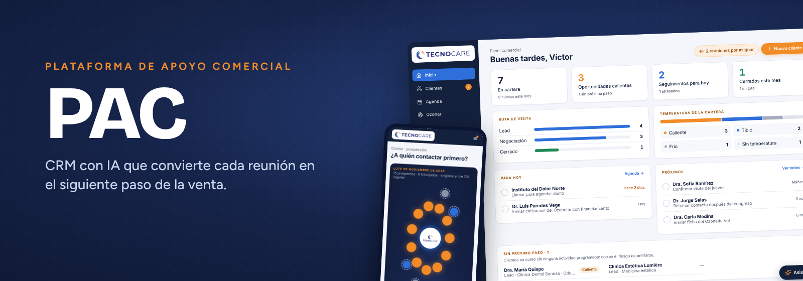
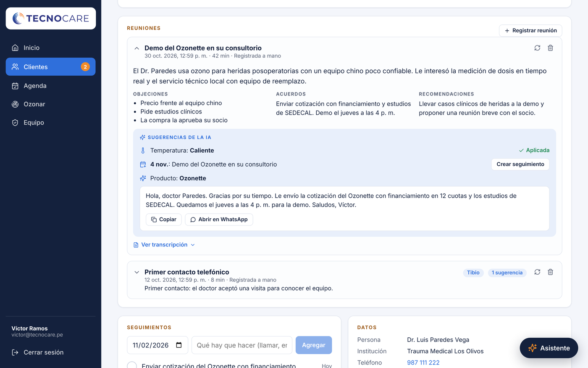
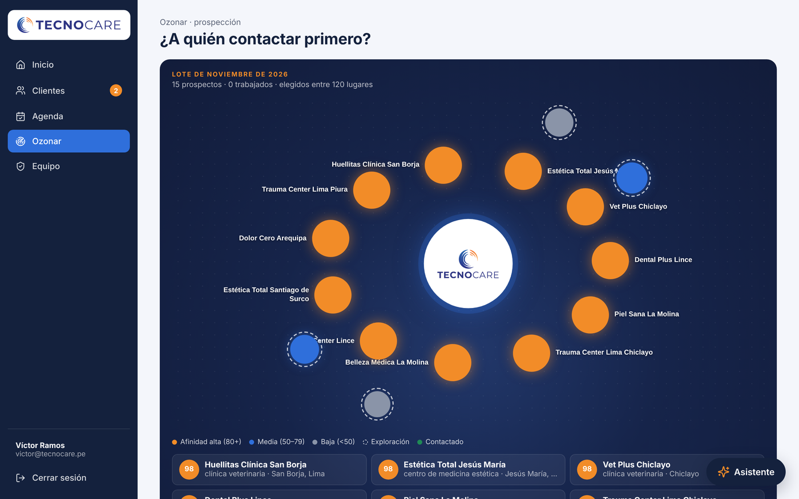
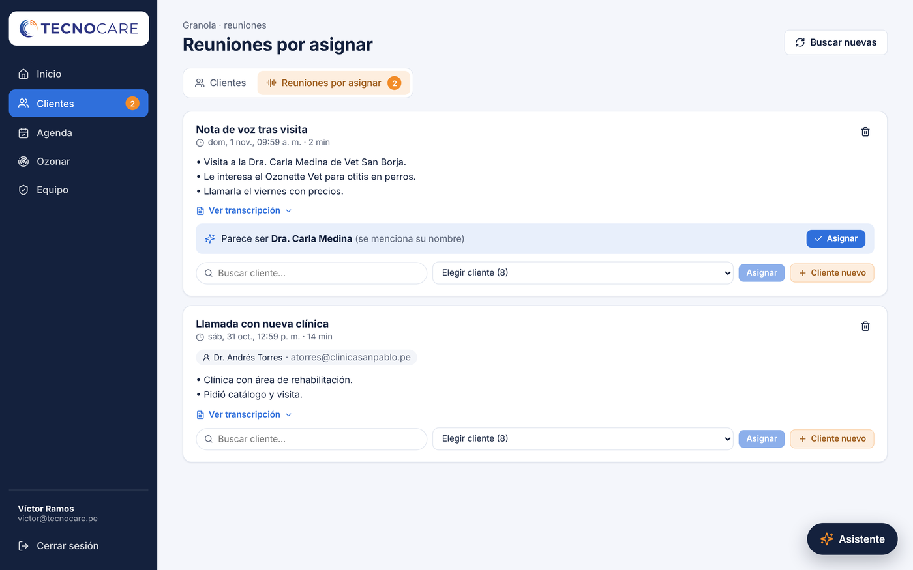
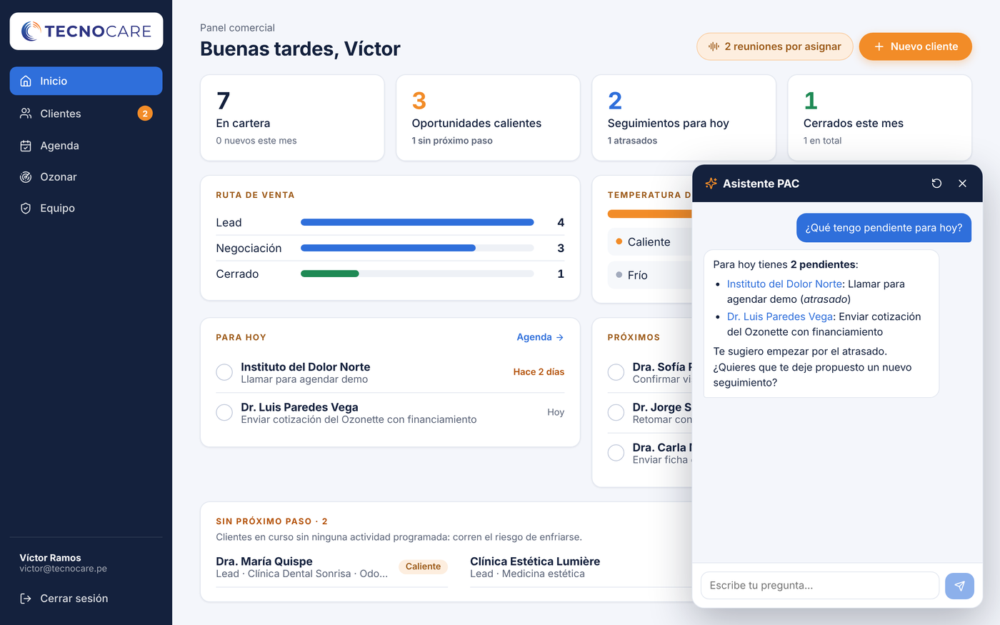
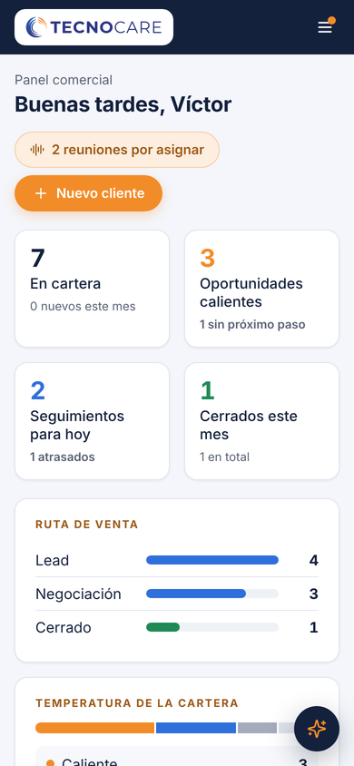
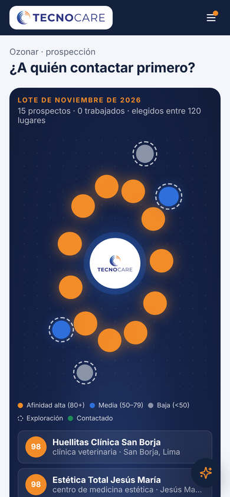
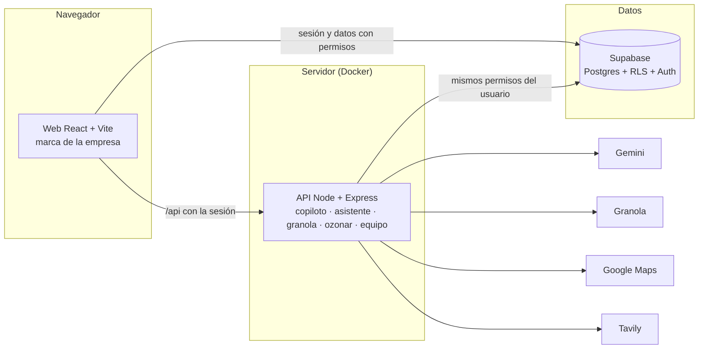

<p align="center">
  
</p>

<p align="center">
  <b>CRM con inteligencia artificial para equipos de venta pequeños.</b><br>
  Cada reunión se convierte en un resumen, una objeción por resolver y el siguiente paso, listo para aplicar con un clic.
</p>

<p align="center">
  
  
  
  
  
  
</p>

---

## Qué hace

| | |
|---|---|
| **Copiloto de reuniones** | Pega una transcripción o deja que llegue de Granola. La IA devuelve resumen, objeciones, acuerdos, recomendaciones, temperatura, seguimiento, producto sugerido y un borrador de WhatsApp. Nada se aplica sin un clic. |
| **Bandeja de Granola** | Las reuniones grabadas (videollamada, presencial o nota de voz) llegan solas. PAC reconoce el cliente por correo, teléfono, nombre o clínica. |
| **Inicio y Agenda** | Indicadores del negocio, ruta de venta, temperatura de la cartera, lo que toca hoy, lo próximo y quién se está quedando sin próximo paso. |
| **Ozonar** | Cada mes, 15 prospectos nuevos descubiertos en Google Maps, leídos en su web con Tavily y puntuados por la IA, con fuentes verificables. Aprende de los 👍/👎. |
| **Asistente PAC** | Un chat que consulta la cartera real («¿qué tengo pendiente hoy?») y propone acciones que se confirman con un botón. |
| **Equipo** | Administradores y vendedores, contraseñas temporales, desactivar sin perder historial. |
| **Una marca por empresa** | Logo, colores, nombre y configuración de prospección en una carpeta. Sin tocar código. |

<table>
  <tr>
    <td width="50%"><p align="center"><sub>Copiloto de reuniones</sub></p></td>
    <td width="50%"><p align="center"><sub>Ozonar: lote mensual de prospectos</sub></p></td>
  </tr>
  <tr>
    <td width="50%"><p align="center"><sub>Reuniones de Granola por asignar</sub></p></td>
    <td width="50%"><p align="center"><sub>Asistente PAC</sub></p></td>
  </tr>
</table>

<p align="center">
  
  &nbsp;&nbsp;
  
</p>

## Cómo está hecho



- **Permisos en la base de datos (RLS):** cada consulta respeta el usuario que la hace, también las del servidor.
- **Claves privadas solo en el servidor:** Gemini, Granola, Google Maps, Tavily y la clave de servicio nunca llegan al navegador.
- **Privacidad:** antes de enviar texto a la IA se ocultan teléfonos, correos y DNI. Las transcripciones se borran solas a los 8 meses; el análisis queda.
- **IA con respaldo:** si un modelo está saturado se usa otro; si fallan todos, la reunión se guarda y se puede reanalizar.

```
apps/web            Pantallas (React + Vite)
apps/server         API, IA e integraciones (Node + Express)
supabase/migrations Base de datos versionada
supabase/seeds      Datos iniciales por empresa
marcas/             Logo, colores y Ozonar de cada empresa
docs/               Imágenes de este README
```

## Empezar en tu computadora

Requiere Node 22.

```bash
cp .env.example .env        # completa la URL y la clave anon de Supabase, y MARCA
npm ci
npx supabase login          # una vez por computadora
npm run db:vincular -- --project-ref <ref>
npm run db:subir            # aplica las migraciones
npm run dev                 # web en http://localhost:5173, API en :3000
```

El primer usuario que se cree en Supabase → Authentication queda como administrador. Los demás se agregan desde **Equipo**.

| Comando | Qué hace |
|---|---|
| `npm run dev` | Web y API con recarga automática |
| `npm run typecheck` | Revisa tipos de web y servidor |
| `npm run build` | Compila para producción |
| `npm run db:estado` | Migraciones aplicadas y pendientes |
| `npm run db:subir` | Aplica las migraciones pendientes |

## Una empresa nueva

1. Copia `marcas/plantilla` como `marcas/<empresa>` y reemplaza logos y colores.
2. En `marca.json`, ajusta la sección `ozonar` (qué buscar, zonas y tamaño del lote).
3. Crea `supabase/seeds/<empresa>.sql` con su catálogo.
4. Usa `MARCA=<empresa>` en el `.env` o como build arg de Docker.

Detalle en [`marcas/README.md`](marcas/README.md).

## Variables de entorno

| Variable | Dónde | Para qué |
|---|---|---|
| `MARCA` | build y servidor | Carpeta de `marcas/` (logo, colores, Ozonar) |
| `VITE_SUPABASE_URL`, `VITE_SUPABASE_ANON_KEY` | build (públicas) | Conexión a Supabase desde la web; el servidor las reutiliza |
| `SUPABASE_SERVICE_ROLE_KEY` | servidor (privada) | Solo para gestionar el equipo (crear, editar, eliminar usuarios) |
| `GEMINI_API_KEY` | servidor (privada) | Copiloto de reuniones, Asistente y puntuación de Ozonar |
| `GRANOLA_API_KEY` | servidor (privada) | Bandeja de reuniones grabadas |
| `GOOGLE_PLACES_API_KEY`, `TAVILY_API_KEY` | servidor (privadas) | Ozonar |
| `GEMINI_MODEL`, `GEMINI_MODEL_RESPALDO`, `GEMINI_MODEL_ASISTENTE` | servidor (opcionales) | Cambiar de modelo sin tocar código |

> Nunca pongas una clave privada en una variable que empiece con `VITE_`: esas se incluyen en la web.

## Publicar con Docker (EasyPanel)

1. Crea la app desde este repositorio con el `Dockerfile` de la raíz.
2. Build args: `MARCA`, `VITE_SUPABASE_URL`, `VITE_SUPABASE_ANON_KEY`.
3. Variables de entorno del contenedor: las privadas de la tabla (nunca como build args).
4. Puerto 3000. Salud: `/api/healthz`.
5. Base de datos: `npm run db:vincular -- --project-ref <ref>` y `npm run db:subir`; luego carga `supabase/seeds/<empresa>.sql` una vez.

En Google Cloud, pon una **cuota diaria** a Places API (New): un presupuesto solo avisa, no detiene el cobro.

---

<p align="center"><sub>© 2026 Rodrigo Torres Rojas. Todos los derechos reservados. Uso bajo licencia.</sub></p>
